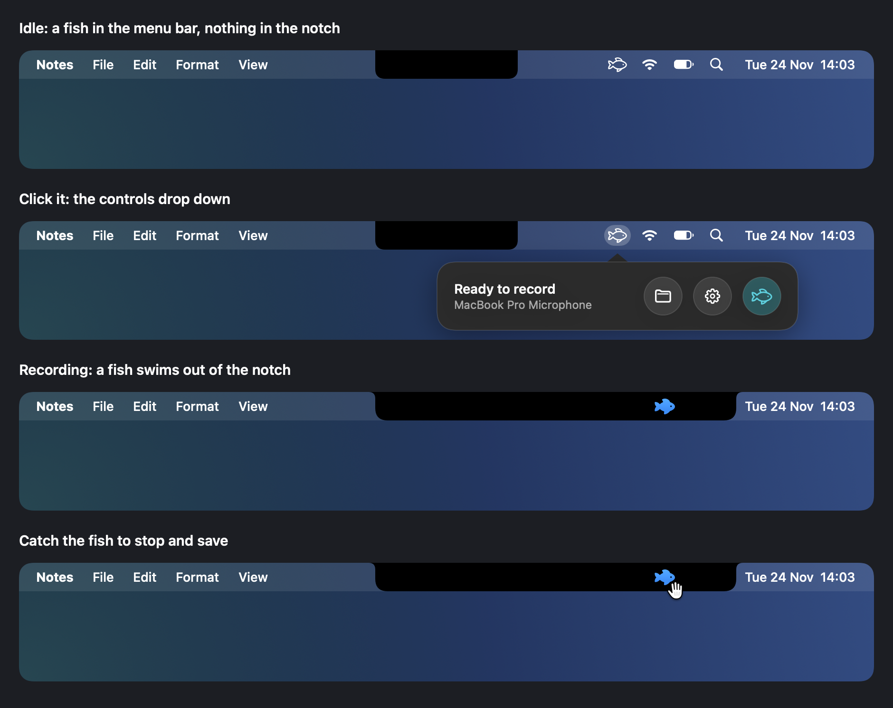
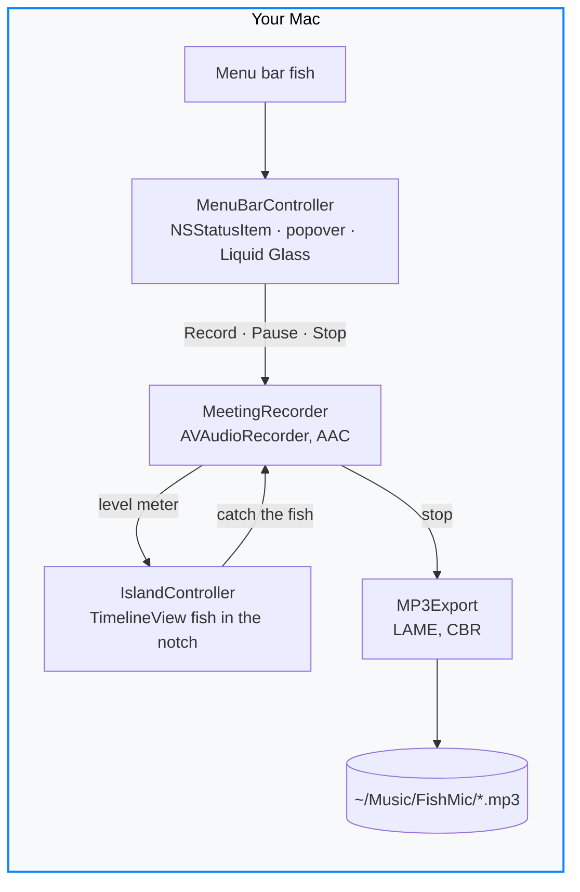

<div align="center">


# FishMic

### A recorder for your goldfish memory: record anything, anytime, straight from the menu bar of your Mac

[](#-install)
[](#-install)
[](#-how-it-works)
[](#-how-it-works)
[](#-ready-for-ai)
[](#%EF%B8%8F-private-by-design)
[](LICENSE)

<br/>


<br/>

**FishMic** is a small fish in your menu bar. Click it, hit record, and it records: a meeting, a lecture, a hallway idea, a call. While it records, a blue fish swims out of your MacBook's camera notch; catch it with the mouse to stop. No window, no Dock icon. You get a small, voice-tuned MP3 that's ready for any AI to transcribe and summarize.

```sh
brew tap flol3622/fishmic https://github.com/flol3622/FishMic
brew trust --formula flol3622/fishmic/fishmic
brew install flol3622/fishmic/fishmic && fishmic
```

</div>

<br/>

---

## 🐠 At a Glance

You leave the meeting, and ten minutes later the decision, the number or the name is gone. FishMic makes capturing it a one-second habit: it's always there, it never gets in the way, and the file it makes is built for transcription.

| | Voice Memos | QuickTime Player | AI meeting bots | **FishMic** |
| :--- | :---: | :---: | :---: | :---: |
| **Start recording** | Open the app, click | File → New Audio Recording | Invite the bot to the call | ✅ **Click the fish in the menu bar** |
| **On screen while recording** | App window | Window | A participant in the call | ✅ **A small fish beside the notch** |
| **In-person conversations** | ✅ | ✅ | ❌ Online calls only | ✅ |
| **Any call app** | ✅ | ✅ | ⚠️ Supported platforms only | ✅ |
| **Audio leaves your Mac** | ⚠️ With iCloud sync | No | ❌ Yes, by design | ✅ **Never** |
| **Starts at login** | ❌ | ❌ | n/a | ✅ |

---

## ✨ Features

- **Subtle.** FishMic has no window and no Dock icon, just a fish in the menu bar. When you're not recording, the notch stays empty.
- **Anytime.** Click the menu bar fish and the controls drop down. One click starts recording. FishMic opens at login, so it's always there after a restart, and ⌘Space finds it like any other app.
- **Alive, not loud.** While recording, a blue fish swims out of the notch. It beats its tail harder when the microphone hears you, so a glance tells you it's working.
- **Catch the fish to stop.** Your pointer turns into a grabbing hand over the fish. Click it and it's caught: the recording is saved with a one-second flourish.
- **Tuned for voice.** Mono MP3 at 24 kHz and 32 kbps, about **15 MB per hour**: speech stays clear and files stay small enough to upload anywhere. Settings has a 48 kbps option, and M4A (AAC) if you'd rather skip the MP3 step.
- **Safe for long meetings.** Audio is written to disk as you record, as AAC; when you stop, FishMic converts it to MP3 in a few seconds and only then removes the AAC file. Your Mac won't go to idle sleep while recording. If the microphone disappears mid-meeting, everything captured so far is kept and FishMic tells you where.
- **Pause and resume** without starting a new file.
- **Native to macOS 26.** SwiftUI and Liquid Glass controls, a spring animation that follows Reduce Motion, VoiceOver labels, and a light trackpad tap when you start or stop.

---

## 📦 Install

**You need:**
- macOS 26 (Tahoe) or later. It works best on a MacBook with a notch; other Macs get a Liquid Glass pill under the menu bar.
- [Homebrew](https://brew.sh) and Apple's Command Line Tools (`xcode-select --install`). Homebrew builds FishMic from source on your Mac, and installs the [LAME](https://lame.sourceforge.io) MP3 encoder it uses.

### Homebrew

```sh
brew tap flol3622/fishmic https://github.com/flol3622/FishMic
brew trust --formula flol3622/fishmic/fishmic
brew install flol3622/fishmic/fishmic
fishmic
```

1. `brew tap` adds this repository as a tap. It's its own tap, so there's nothing else to add.
2. `brew trust` is how Homebrew 7 asks you to approve formulae from outside its official taps. Skip it on older Homebrew.
3. `fishmic` starts the app. From then on, FishMic opens at login by itself. It also puts a small launcher in `~/Applications`, so you can start it with ⌘Space: type "fishmic" and press Return. (Spotlight doesn't look inside Homebrew's folders, hence the launcher.)

On your first recording, macOS asks for microphone access. Click **Allow**.

**Update** with `brew upgrade flol3622/fishmic/fishmic`, or follow `main` with `brew install --HEAD flol3622/fishmic/fishmic`.

**Uninstall:** in FishMic's Settings, turn off **Open at login** and click **Quit FishMic**, then:

```sh
brew uninstall flol3622/fishmic/fishmic
brew untap flol3622/fishmic
rm -rf ~/Applications/"FishMic.app"
```

Your recordings stay in their folder.

### Coming from Mic Mini?

FishMic is the new name of Mic Mini (0.3.1 and earlier). `brew upgrade` doesn't carry you across, so swap it once. In Mic Mini's Settings, turn off **Open at login** and click **Quit Mic Mini**, then:

```sh
brew uninstall flol3622/mic-mini/mic-mini
brew untap flol3622/mic-mini
rm -rf ~/Applications/"Mic Mini.app"
```

Then [install FishMic](#homebrew). It starts with default settings and saves to `~/Music/FishMic`. Your old recordings stay in `~/Music/Mic Mini`: move them over, or pick that folder in Settings.

---

## 🎙️ Use It



1. **Record.** Click the fish in the menu bar, then the teal **fish** button.
2. **Keep going.** The blue fish swims out of the notch while you record, and the menu bar fish turns red. Click the menu bar fish to **pause**, **resume** or **stop**. Paused time isn't recorded.
3. **Or catch it.** Click the swimming fish itself to stop and save.
4. **Find it.** The menu bar shows a download arrow for the few seconds it takes to make the MP3, then a green check confirms the save. Open the menu bar fish to see the recording's name, and click it to show the file in Finder. The **folder** button opens all your recordings. Right-click the menu bar fish for Settings and Quit.

Recordings go to `~/Music/FishMic` by default, named by date and time, such as `Meeting 2026-11-24 14.03.11.mp3`, so they sort chronologically. **Settings** (the gear) changes the folder, the format (MP3 or M4A), the audio quality and **Open at login**, and has **Quit FishMic**.

> **Online meetings:** FishMic records the microphone, not your Mac's sound output. With headphones on, you get your side of the call. Without headphones, the microphone usually picks up both sides from the speakers.

---

## 🤖 Ready for AI

FishMic's files are made to be handed to a model: mono, speech-tuned, and small.

| Setting | Format | Size per hour | Fits in a 25 MB upload |
| :--- | :--- | :---: | :---: |
| **MP3 · Compact** (default) | MP3 · 24 kHz · mono · 32 kbps CBR · `.mp3` | ~15 MB | ~1 h 40 min |
| **MP3 · Higher quality** | MP3 · 24 kHz · mono · 48 kbps CBR · `.mp3` | ~22 MB | ~1 h 10 min |
| **M4A · Compact** | AAC · 24 kHz · mono · 32 kbps · `.m4a` | ~15 MB | ~1 h 40 min |
| **M4A · Higher quality** | AAC · 24 kHz · mono · 48 kbps · `.m4a` | ~22 MB | ~1 h 10 min |

MP3 is the default because everything takes it: every player, every upload form, every transcription service. At the same size, AAC sounds a little cleaner, so pick M4A if your tools accept it.

Some ways to use them:

- **Google Gemini:** attach the file in [Google AI Studio](https://aistudio.google.com), or upload it with the [Files API](https://ai.google.dev/gemini-api/docs/audio) for long recordings, then ask for a transcript.
- **OpenAI:** the [speech-to-text API](https://platform.openai.com/docs/guides/speech-to-text) takes `.mp3` and `.m4a` files up to 25 MB.
- **On your Mac:** [MacWhisper](https://goodsnooze.gumroad.com/l/macwhisper) opens the file directly. For [whisper.cpp](https://github.com/ggml-org/whisper.cpp), convert it first with `ffmpeg -i "Meeting….mp3" -ar 16000 -ac 1 meeting.wav`.

Then put the transcript to work. A prompt that does most of the remembering for you:

> *"Transcribe this meeting with timestamps and speaker labels. Then list the decisions, the action items with owners and deadlines, the numbers mentioned, and the open questions."*

---

## 🛡️ Private by Design

- **No network access.** FishMic contains no networking code. Recordings stay in your folder until you decide to share them.
- **Nothing runs until you click.** FishMic only opens the microphone when you press the fish, and closes it when you stop.
- **Only what you need.** The one permission it asks for is the microphone. Catching the fish uses ordinary mouse events, so it doesn't need Accessibility or Screen Recording access.

> **Record responsibly.** FishMic is deliberately unobtrusive, and while recording, the fish's lane covers the part of the menu bar where macOS usually shows its orange microphone indicator. Recording people without their consent is illegal in many places. Tell the people you record.

---

## 🔬 How It Works



1. **A menu bar home.** An `NSStatusItem` opens a popover with the controls. They use SwiftUI's interactive `glassEffect` inside a `GlassEffectContainer`, so they respond to your press and morph between Record and Stop.
2. **An island that is part of the notch.** While recording, a borderless, transparent panel just above the menu bar draws a black island flush with the top edge, with concave top corners, so it reads as the notch growing. It takes the clicks on itself and lets every other click through.
3. **Catch it without permissions.** The panel knows where the fish is from the same clock that animates it, and checks your click against it. A global mouse-moved monitor shows the grabbing hand; mouse movement doesn't need Accessibility access, unlike key events.
4. **A fish that listens.** A `TimelineView` swims the fish along its lane; the tail's beat follows `AVAudioRecorder`'s level meter, sampled 12 times per second.
5. **Recording that survives.** `AVAudioRecorder` streams AAC to disk. A `ProcessInfo` activity holds off idle sleep, and a watchdog notices when the input device vanishes without telling anyone.
6. **MP3 when you stop.** macOS can't encode MP3, so FishMic decodes the AAC with `AVAudioFile` and encodes it with [LAME](https://lame.sourceforge.io) on a background thread, about 10 seconds per hour of audio. The MP3 is written under a hidden name and renamed when complete; the AAC file is removed only after that, so a failed conversion loses nothing. Quitting waits for a conversion in progress.
7. **Back after a restart.** **Open at login** uses `SMAppService`, the same login items you see in System Settings → General → Login Items & Extensions.

---

## ⚠️ Limitations

- **macOS 26 or later.** FishMic uses Liquid Glass and other macOS 26 SwiftUI APIs.
- **Microphone only.** It doesn't capture your Mac's sound output. See [Online meetings](#%EF%B8%8F-use-it).
- **Permission after each update.** Homebrew builds FishMic on your Mac and signs it ad hoc, so macOS treats every new build as a new app and asks for microphone access again.
- **A fixed lane.** While recording, the island covers about 418 points of the menu bar to the right of the notch. Menu bar icons there are hidden until you stop, which can include FishMic's own (stop by catching the fish, or ⌘-drag the icon further right). That also includes the microphone indicator, whichever app is using the microphone.
- **One screen.** The island appears on the display with a notch, or on the main display if there's none.

---

## 🛠️ Development

```text
Sources/FishMic.swift          app delegate: wires the menu bar, island, recorder and settings
Sources/MenuBar.swift          menu bar item, popover controls, right-click menu
Sources/Island.swift           the notch island while recording: panel, swimming fish, catch animation
Sources/Launcher.swift         the ~/Applications launcher that lets Spotlight find a Homebrew install
Sources/MeetingRecorder.swift  AVAudioRecorder: start, pause, resume, stop, level meter
Sources/MP3Export.swift        AAC → MP3 conversion with LAME when a recording stops
Sources/Lame.h                 bridging header that imports LAME into Swift
Sources/Settings.swift         preferences, Open at login, settings window
app/Info.plist                 bundle: LSUIElement (no Dock icon), microphone usage text
app/AppIcon.icns               app icon, made from assets/logo.svg
scripts/build.sh               swiftc + LAME → dist/FishMic.app, ad-hoc signed
scripts/install.sh             installs the current checkout through a local Homebrew tap
Formula/fishmic.rb             the public Homebrew formula (this repository is its own tap)
```

```sh
brew install lame                  # the MP3 encoder (Homebrew installs it for you otherwise)
./scripts/build.sh                 # dist/FishMic.app
open "dist/FishMic.app"
./scripts/install.sh               # or install the checkout with Homebrew
```

The build uses only `swiftc` from the Command Line Tools and Homebrew's `lame`, with no Xcode project. `build.sh` finds LAME with `brew --prefix lame`, or `LAME_PREFIX` if set (the formula sets it). That's why the SwiftUI code avoids `@State`: in the macOS 26 SDK it's a macro whose plugin ships with Xcode only.

**To release:** bump `CFBundleShortVersionString` and `CFBundleVersion` in `app/Info.plist`, set the same version in the `tag:` of `Formula/fishmic.rb`, commit, then tag `vX.Y.Z` and push the tag.

---

## 📖 Acknowledgements

- Inspired by the Dynamic Island on iPhone, and by everyone who has ever said *"wait, what did we decide?"*
- Built with [Claude Code](https://claude.com/claude-code).

---

<div align="center">
  <b>MIT License</b> · Not affiliated with Apple. Mac, MacBook, Dynamic Island and Liquid Glass are trademarks of Apple Inc.
</div>
